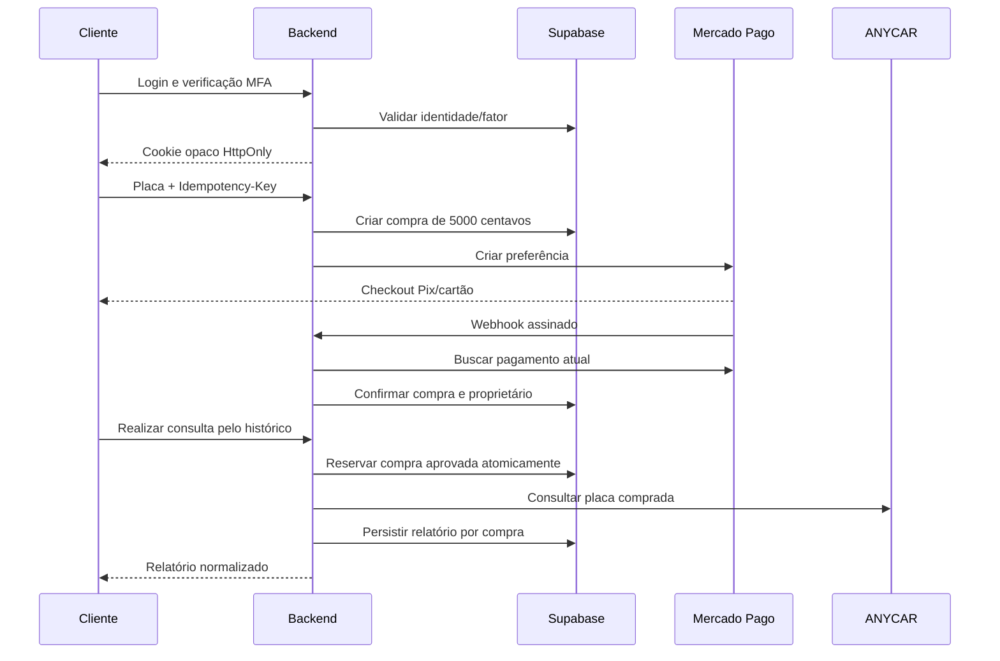

# Arquitetura e decisões de segurança

O navegador só fala com o backend da aplicação. O backend usa Supabase Auth para verificar identidade e PostgreSQL no schema privado benz para sessões, compras e consultas. As integrações faturáveis nunca são chamadas diretamente pelo frontend.

## Autenticação
- Supabase armazena bcrypt/salt. A aplicação não cria uma tabela de senhas.
- Cookie aleatório de 32 bytes, hash no banco, HttpOnly e SameSite=Lax. Em produção: Secure e prefixo __Host-.
- Access/refresh tokens criptografados com AES-256-GCM e nonce aleatório, chave fora do banco.
- Rotação de refresh token serializada por lock da sessão no PostgreSQL.
- Identidade validada com getUser. Não há autorização por user_metadata, localStorage ou JWT entregue pelo navegador.
- Inatividade de 30 minutos verificada no servidor antes de cada operação. Somente interação real gera heartbeat; polling não prolonga sessão.
- Limite absoluto de sessão de 24 horas. Logout, bloqueio e recuperação revogam sessões locais pertinentes.
- Após cinco credenciais inválidas, bloqueio persistente por HMAC do e-mail normalizado. Incremento/checagem serializados para evitar corridas.
- Recuperação por token_hash cria sessão restrita. Só a troca de senha permite liberar o bloqueio; MFA existente é preservado.
- Google usa PKCE, cookie temporário criptografado, vínculo de flow e TTL.
- MFA exigido no servidor; challenge e fator são vinculados à sessão. Enrollment novo não substitui silenciosamente fator verificado.

## Banco e autorização
O schema benz não deve ser exposto pelo Data API. Todas as tabelas têm RLS, sem permissões/políticas para anon ou authenticated. O papel de runtime possui políticas explícitas e acesso limitado ao schema da aplicação; cada operação do backend também impõe user_id. O papel não precisa ler auth.users.

Não há DDL automático ao iniciar o servidor. Migration e runtime-role.sql são aplicados por um operador. Conexões de produção validam certificados TLS. A senha da conexão deve pertencer a um login restrito, não ao administrador.

## Compra, concorrência e fraude
O servidor define R$ 50,00 e o banco reforça o valor por CHECK. A entrada do checkout aceita somente placa. Uma chave UUID de idempotência pertence a usuário e placa; o lock impede duas preferências na mesma solicitação normal.

O webhook exige identificador na query, assinatura HMAC-SHA256, timestamp dentro de cinco minutos e request ID. O body é apenas sinal. A Payments API autenticada precisa confirmar referência, valor, BRL, recebedor, ambiente e estado atual.

As notificações ficam em webhook_jobs. Processamento repetido não concede outro crédito. O recurso é buscado de novo após o lock da compra para evitar aplicação de um snapshot atrasado. Estorno e chargeback não são revertidos por uma aprovação antiga.

Uma compra só pode reservar uma execução de relatório. Chamadas concorrentes veem processing/complete; releituras usam o documento salvo. Não há token avulso que dispense login ou permita trocar a placa.

Não existe garantia de exactly-once entre uma API externa e o PostgreSQL sem suporte transacional/idempotente do fornecedor. Por isso, timeout, crash ou falha após iniciar a chamada geram review, sem repetição automática faturável. O operador concilia com a ANYCAR. Isso preserva o dinheiro do cliente e evita duplicar consumo sem evidência.

## Controles complementares
Origem exata, JSON e cabeçalho próprio nas mutações; exceção autenticada por assinatura para o webhook. Cookie no mesmo domínio. Helmet/CSP, limites de body, timeout, redirecionamentos externos desabilitados em chamadas de credenciais e erros sem stack/segredos.

Rate limits persistem no banco e funcionam em múltiplas instâncias. Configure corretamente o proxy de origem e também os limites de Supabase/gateway. A chave HMAC das tentativas deve ser independente da chave de sessão.

Dados brutos da ANYCAR não são entregues nem armazenados automaticamente. O normalizador deve ser revisado contra o contrato. Valores ausentes não significam ausência de risco.

## Operação e limites
Solicitar estorno não significa dinheiro devolvido. O protocolo é persistido; o operador executa a devolução no Mercado Pago, acompanha o webhook e trata compras em análise. Não há painel administrativo ou estorno automático.

Manutenção reprocessa notificações recebidas, não descobre todos os pagamentos sem webhook. Conciliação operacional e reenvio pelo gateway continuam necessários. Tickets e jobs que excedam as tentativas exigem acompanhamento.

Confirmação de e-mail, SMTP, SMS, Google, regras de retenção, backup, recuperação de MFA e configuração de provedores são condições externas que precisam de homologação. Os arquivos de deploy não foram publicados.

Referências: [Supabase Auth](https://supabase.com/docs/guides/auth/password-security), [RLS](https://supabase.com/docs/guides/database/postgres/row-level-security), [Webhooks Mercado Pago](https://github.com/mercadopago/sdk-nodejs/blob/master/docs/webhooks.md).
